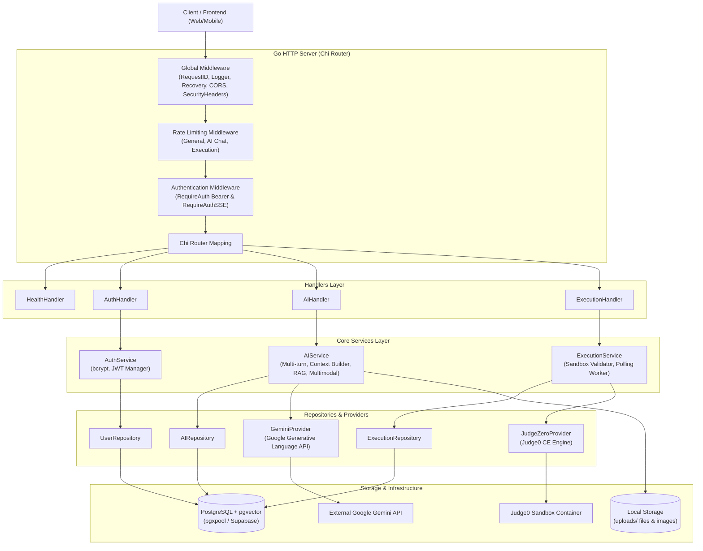
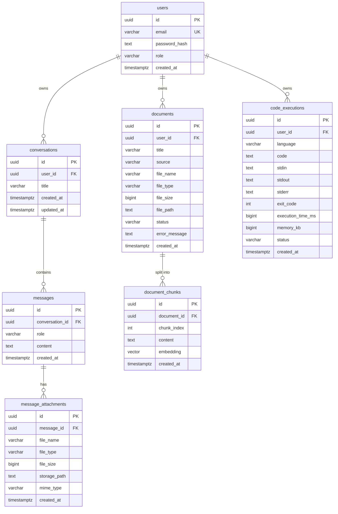

# System Architecture

## Overview

Backend ini dibangun sebagai platform **AI Assistant, Multimodal Generator, RAG Knowledge Base, dan Code Execution Sandbox** yang tangguh dan modular menggunakan Go (Golang).

Sistem menerapkan prinsip **Clean Architecture**, **Dependency Injection**, dan **Domain-Driven Modularization** untuk memastikan kode tetap decoupled, mudah diuji (*testable*), serta siap dikembangkan untuk kebutuhan bisnis tingkat lanjut.

### Prinsip Desain Utama

1. **Separation of Concerns & Unidirectional Data Flow**:
   - `Handler` menangani parsing HTTP, validasi request, dan formatting response.
   - `Service` mengelola orkestrasi logika bisnis, koordinasi RAG, aturan validasi multimodal, dan eksekusi sandbox.
   - `Repository` mengelola akses database PostgreSQL murni menggunakan parameterized query.
   - `Provider` mengisolasi komunikasi dengan pihak ketiga (Google Gemini API, Judge0 CE engine).
2. **Dependency Injection**: Seluruh komponen, koneksi database, logger, dan provider diinisialisasi secara eksplisit di [cmd/server/main.go](file:///C:/project/pakhir/be/cmd/server/main.go) dan diinjeksikan ke router tanpa global mutable state.
3. **Abstraction Over Implementation**: AI service dan Execution service berinteraksi melalui interface (`provider.Provider` dan `provider.ExecutionProvider`), memungkinkan pergantian provider model tanpa mengubah business logic.
4. **Fail-Fast Startup**: Konfigurasi divalidasi saat startup ([internal/config/config.go](file:///C:/project/pakhir/be/internal/config/config.go)), database di-ping dengan batas timeout ([storage/supabase.go](file:///C:/project/pakhir/be/storage/supabase.go)), dan migrasi SQL dijalankan secara otomatis saat server boot.
5. **Safe by Default & Defense in Depth**:
   - Error internal dan detail SQL tidak pernah bocor ke client ([internal/apperror](file:///C:/project/pakhir/be/internal/apperror)).
   - Input divalidasi ketat (whitelist bahasa pada sandbox, MIME sniffing pada berkas gambar dan dokumen).
   - Isolasi kepemilikan resource per user (`user_id = $2`) pada seluruh query database.
   - Rate limiting bertingkat (General API, AI Chat, dan Code Execution).

---

## High-Level Architecture Diagram



---

## Request Flow & Middleware Architecture

Setiap request HTTP melalui rantai middleware bertingkat yang dirancang untuk stabilitas, keamanan, dan perlindungan kuota:

```
Request Masuk
     │
     ▼
[Global Middlewares]
 ├─ RequestID       → Menghasilkan / memvalidasi X-Request-ID unik untuk trace log & response.
 ├─ RequestLogger   → Structured JSON/text log (metode, path, IP, status, durasi).
 ├─ Recovery        → Menangkap panic, mengembalikan 500 aman, mencatat stacktrace ke log internal.
 ├─ CORS            → Memvalidasi origin berdasarkan CORS_ALLOWED_ORIGINS.
 └─ SecurityHeaders → Menambahkan X-Content-Type-Options: nosniff, Frame Options, Referrer Policy.
     │
     ▼
[/api/v1 Group]
 ├─ General RateLimit (120 req/min default)
 │
 ├─ [Public Group]
 │   ├─ POST /auth/register
 │   ├─ POST /auth/login
 │   └─ GET  /ai/health
 │
 ├─ [Protected Group: RequireAuth (JWT Bearer)]
 │   ├─ GET /auth/me
 │   │
 │   ├─ [Execution Group: Dedicated Strict RateLimit (15 req/min)]
 │   │   ├─ POST /execute
 │   │   ├─ GET  /execute/history
 │   │   └─ GET  /execute/{id}
 │   │
 │   └─ [AI & Document Group: Dedicated Chat RateLimit (10 req/min)]
 │       ├─ POST   /ai/chat (JSON & multipart)
 │       ├─ GET    /ai/conversations
 │       ├─ GET    /ai/conversations/{id}
 │       ├─ DELETE /ai/conversations/{id}
 │       ├─ GET    /ai/attachments/{id}
 │       ├─ POST   /ai/documents
 │       ├─ POST   /ai/documents/upload
 │       ├─ GET    /ai/documents
 │       ├─ GET    /ai/documents/{id}
 │       ├─ GET    /ai/documents/{id}/status
 │       └─ DELETE /ai/documents/{id}
 │
 └─ [Streaming Group: RequireAuthSSE (?token= atau Bearer)]
     └─ POST /ai/chat/stream
```

---

## Detailed Subsystem Breakdown

### 1. Authentication & Security Subsystem
- **Password Hashing**: Menggunakan `bcrypt` dengan cost terstandar. Plaintext password tidak pernah disimpan atau dicatat ke log.
- **JWT Management**: Ditandatangani menggunakan algoritma HMAC-SHA256 (`HS256`) dengan secret dari `JWT_SECRET`.
  - Claims standar: `sub` (User UUID), `email`, `role`, `iss`, `iat`, `exp`.
  - `RequireAuth`: Memvalidasi header `Authorization: Bearer <token>`, mem-parse claims, dan menyisipkan `userID` ke dalam `context.Context`.
  - `RequireAuthSSE`: Middleware khusus yang memeriksa header `Authorization` terlebih dahulu; bila tidak ada, memeriksa query parameter `?token=`. Khusus digunakan pada rute SSE streaming.

### 2. AI Assistant & Multimodal Subsystem (`internal/modules/ai`)
- **Conversation & Memory Context**:
  - Menyimpan riwayat percakapan secara terstruktur di database (`conversations` dan `messages`).
  - Saat request prompt baru diterima, context builder (`buildProviderMessages`) menyusun riwayat pesan terdahulu (default 10 pesan terakhir) untuk mempertahankan memori percakapan multi-turn.
- **Multimodal Image Support**:
  - Menerima berkas gambar baik melalui payload `application/json` (base64) maupun `multipart/form-data`.
  - Validasi ketat format MIME (`image/jpeg`, `image/png`, `image/webp`) dan batasan ukuran berkas (`UPLOAD_MAX_BYTES`).
  - Berkas fisik disimpan ke direktori lokal terisolasi (`uploads/`) dengan nama UUID unik.
  - Metadata disimpan ke tabel `message_attachments`.
  - Gambar dikirimkan ke model Gemini melalui inline data parts.
  - Endpoint `GET /api/v1/ai/attachments/{id}` memverifikasi kepemilikan percakapan sebelum mengalirkan berkas biner ke browser.
- **RAG (Retrieval-Augmented Generation)**:
  - **Ingestion**: Dokumen dipecah menjadi fragmen teks menggunakan semantic chunker (`rag.NewChunker(800, 150)`) dengan window overlap untuk mencegah hilangnya konteks di perbatasan chunk.
  - **Embedding**: Fragmen teks diubah menjadi vektor 768 dimensi menggunakan model `text-embedding-004`.
  - **Vector Storage & Search**: Vektor disimpan pada kolom `embedding VECTOR(768)` di PostgreSQL menggunakan ekstensi `pgvector`.
  - **Similarity Matching**: Menggunakan cosine distance (`<=>`) untuk menemukan potongan teks paling relevan terhadap query pengguna dan disisipkan ke prompt sebelum dikirim ke LLM.
- **Asynchronous Document Extraction**:
  - File dokumen yang diunggah (`.pdf`, `.docx`, `.txt`) disimpan ke storage lokal.
  - Backend menjalankan goroutine background worker untuk mengekstraksi teks dokumen menggunakan parser khusus:
    - PDF: `extractor/pdf.go` (menggunakan library `dslipak/pdf`).
    - DOCX: `extractor/docx.go` (unzip XML reader).
    - TXT: `extractor/txt.go`.
  - Status pemrosesan dicatat di kolom `status` (`processing` -> `ready` / `failed`) yang dapat dipantau oleh frontend melalui polling status.

### 3. Code Execution Sandbox Subsystem (`internal/modules/execution`)
- **Sandboxing Engine**: Berintegrasi dengan **Judge0 CE** (API self-hosted via Docker atau cloud).
- **Execution Pipeline**:
  1. Validasi bahasa terhadap whitelist (`python`, `javascript`, `go`).
  2. Validasi ukuran payload kode (maksimal `EXEC_MAX_CODE_BYTES`, default 64 KB).
  3. Mengirim payload submission ke Judge0 (`POST /submissions?base64_encoded=false&wait=false`).
  4. Polling status eksekusi secara asinkron dengan interval `EXEC_POLL_INTERVAL` (default 250ms) hingga batas `EXEC_MAX_POLL_DURATION` (default 15s).
  5. Mencatat hasil eksekusi (stdout, stderr, exit code, execution time, memory usage, status) ke tabel `code_executions` dengan asosiasi `user_id`.
- **Resource Enforcement**:
  - CPU Time Limit: `EXEC_CPU_TIME_LIMIT_SEC` (default 5.0 detik).
  - Wall Time Limit: `EXEC_WALL_TIME_LIMIT_SEC` (default 10.0 detik).
  - Memory Limit: `EXEC_MEMORY_LIMIT_KB` (default 128 MB).

---

## Database Architecture & Migrations

Database menggunakan PostgreSQL dengan connection pool `pgxpool` yang dikelola oleh wrapper [storage/supabase.go](file:///C:/project/pakhir/be/storage/supabase.go).

Migrasi database dikelola secara terpusat di direktori [migrations/](file:///C:/project/pakhir/be/migrations/) dan di-embed ke dalam binary menggunakan `embed.FS` (`golang-migrate`), sehingga migrasi berjalan otomatis saat aplikasi dijalankan:

### Urutan Skema Migrasi:

| Nomor | File Migrasi | Deskripsi & Entitas |
| --- | --- | --- |
| `0001` | `0001_init` | Tabel `users` (id, email, password_hash, role, created_at) |
| `0002-0004` | `company_profile_rag` & cleanup | Migrasi transisi & pembersihan skema legacy |
| `0005` | `0005_conversations` | Tabel `conversations` dan `messages` untuk riwayat chat multi-turn |
| `0006` | `0006_rag_documents` | Ekstensi `vector` (`pgvector`), tabel `documents` & `document_chunks` |
| `0007` | `0007_document_uploads` | Menambahkan kolom `file_name`, `file_type`, `file_size`, `status`, `error_message` pada `documents` |
| `0008` | `0008_message_attachments` | Tabel `message_attachments` untuk file gambar percakapan multimodal |
| `0009` | `0009_code_executions` | Tabel `code_executions` untuk riwayat eksekusi kode Judge0 sandbox |

### Entity-Relationship Diagram (ERD)



---

## Directory & Package Organization

```
backend/
├── cmd/
│   └── server/
│       └── main.go           # Entrypoint: Dependency injection, signal handling, graceful shutdown
├── internal/
│   ├── apperror/             # Sentralisasi typed errors & HTTP mapping yang aman
│   ├── config/               # Environment parser, casting, validasi fail-fast
│   ├── database/             # Postgres connection pool runner & embedded migrator
│   ├── handler/              # Handler untuk Health dan Auth
│   ├── jwt/                  # JWT token generator, parser, dan validator
│   ├── middleware/           # Pipeline middleware (Auth, SSE Auth, CORS, Logger, RateLimit, dll)
│   ├── model/                # User model & auth DTOs
│   ├── modules/
│   │   ├── ai/               # Domain Modul AI Assistant & RAG
│   │   │   ├── extractor/    # Document parsers (PDF, DOCX, TXT)
│   │   │   ├── handler/      # HTTP handlers & SSE stream writer
│   │   │   ├── model/        # AI, Conversation, RAG & Attachment models
│   │   │   ├── provider/     # Provider abstraction & Gemini implementation
│   │   │   ├── rag/          # Text chunker & overlap calculator
│   │   │   ├── repository/   # Parameterized SQL queries untuk AI & RAG
│   │   │   └── service/      # Business logic, multimodal, context memory, vector search
│   │   ├── execution/        # Domain Modul Code Execution Sandbox
│   │   │   ├── handler/      # HTTP handlers untuk /execute
│   │   │   ├── model/        # DTO & Database models eksekusi kode
│   │   │   ├── repository/   # SQL queries untuk riwayat eksekusi
│   │   │   └── service/      # Sandbox polling orchestrator & language validation
│   │   └── business/         # Template/scaffold untuk modul bisnis masa depan
│   ├── repository/           # Repository User dasar
│   ├── routes/               # Routing Chi & middleware wiring
│   └── service/              # Service Auth
├── migrations/               # Berkas migrasi SQL berurutan (0001 s.d. 0009)
├── pkg/
│   ├── logger/               # slog wrapper (text untuk dev, JSON untuk prod)
│   └── response/             # Format response standar JSON & request validator
├── storage/                  # Supabase & PostgreSQL pool integration
├── uploads/                  # Penyimpanan berkas lokal (dokumen & gambar lampiran)
└── docs/                     # Dokumentasi API, Arsitektur, dan Client Requirements
```

---

## Observability & Error Handling

1. **Structured Logging**: Menggunakan pustaka standar `log/slog`.
   - Environment `development`: Text format dengan level `DEBUG`.
   - Environment `production`: Structured JSON format dengan level `INFO`.
   - Data sensitif (password, secret, JWT, API key) tidak pernah di-log.
2. **Canonical Error Handling**:
   - `apperror.Error` membungkus status HTTP dan kode error standar.
   - Pesan error internal (`Err`) hanya dicatat pada server log; pesan ke client (`Message`) selalu aman dan disaring.
3. **Graceful Shutdown**:
   - Menangkap sinyal `SIGINT` (Ctrl+C) dan `SIGTERM`.
   - Mengalokasikan window 30 detik untuk menyelesaikan request in-flight (seperti stream AI atau eksekusi sandbox) sebelum server ditutup secara bersih.
