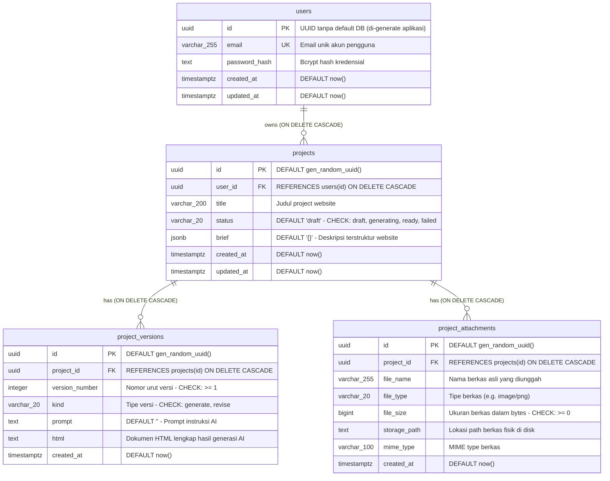

# Dokumentasi Skema Database Final — AI Website Generator

Dokumen ini merupakan spesifikasi definitif skema database relasional untuk backend **AI Website Generator** (Go + PostgreSQL 17, dikelola via `golang-migrate`, versi migrasi aktif = **12**, `dirty = false`). Dokumen ini disusun berdasarkan fakta empiris dari database yang hidup (`pakhir_test`) dan diverifikasi silang dengan file migrasi `0001` hingga `0012`.

---

## 0. Ringkasan Keputusan Arsitektur Database

| Aspek | Keputusan / Implementasi | Bukti Empiris di Database |
| :--- | :--- | :--- |
| **DBMS** | PostgreSQL 17.11 (Debian 17.11-1.pgdg12+2) | `SELECT version();` |
| **Tipe Primary Key** | UUID (Universally Unique Identifier). Pada `projects`, `project_versions`, dan `project_attachments`, nilai default di-generate oleh `gen_random_uuid()`. Pada tabel `users`, PK di-generate oleh aplikasi (Go `uuid.NewString()`) saat proses registrasi. | DDL constraint `PRIMARY KEY (id)`, kolom `column_default` |
| **Konvensi Penamaan** | Snake_case untuk tabel dan kolom (jamak untuk tabel: `users`, `projects`, `project_versions`, `project_attachments`). Constraint diberi prefiks penanda: `chk_*` (CHECK), `idx_*` (INDEX performa), `uq_*` (UNIQUE), `*_fkey` (Foreign Key), `*_pkey` (Primary Key). | `information_schema.columns`, `pg_constraint`, `pg_indexes` |
| **Audit & Timestamp** | Kolom `created_at` dan `updated_at` bertipe `TIMESTAMPTZ` (`timestamp with time zone`) dengan default `now()`. Aplikasi bertanggung jawab memperbarui `updated_at` saat mutasi data (`UPDATE ... updated_at = NOW()`). Tidak menggunakan trigger implisit. | `information_schema.columns` (`udt_name: timestamptz`, `column_default: now()`) |
| **Penyimpanan File** | Skema database hanya menyimpan metadata berkas (`file_name`, `file_type`, `file_size`, `mime_type`) dan path relatif berkas fisik (`storage_path` bertipe `TEXT`). Berkas gambar referensi disimpan di disk lokal dalam direktori terisolasi `uploads/{user_id}/{project_id}/...`. | Tabel `project_attachments`, service [`images.go`](file:///C:/project/pakhir/be/internal/modules/project/service/images.go#L82) |
| **Kebijakan Hapus** | **Hard Delete murni** dengan integritas referensial kaskade penuh (`ON DELETE CASCADE`). Tidak ada kolom `deleted_at`, tidak ada status `is_deleted`, dan tidak ada soft delete di tabel mana pun. Menghapus satu pengguna akan menghapus seluruh project miliknya beserta seluruh iterasi versi dan lampirannya. | DDL FK: `ON DELETE CASCADE` di seluruh foreign key |
| **Extension Aktif** | 1. `pgcrypto` (v1.3): Menyediakan fungsi hashing dan `gen_random_uuid()`.<br>2. `vector` (v0.8.7): Extension tipe data vektor 768 dimensi peninggalan modul RAG legacy. Tetap terpasang pada skema `public` namun tidak direferensikan oleh kolom tabel aktif. | `SELECT extname, extversion FROM pg_extension;` |

---

## 1. Daftar Tabel

Aplikasi memiliki **4 tabel entitas inti** dan **1 tabel infrastruktur**:

1. **`users`**
   - **Fungsi:** Fondasi autentikasi dan identitas pengguna (register, login, profil).
   - **Alasan Keberadaan:** Menampung akun pemilik project website. Kolom `role` telah dihapus pada migrasi `0011` karena seluruh pengguna berkedudukan setara sebagai pemilik resource mereka masing-masing.

2. **`projects`**
   - **Fungsi:** Entitas agregat utama generator website.
   - **Alasan Keberadaan:** Menyimpan metadata website yang dirancang pengguna, instruksi dan spesifikasi terstruktur (`brief` dalam format JSONB), judul project, serta state machine proses pembuatan website (`status`).

3. **`project_versions`**
   - **Fungsi:** Riwayat iterasi dokumen website (kode HTML).
   - **Alasan Keberadaan:** Mendukung fitur riwayat generasi dan revisi bertingkat (*version control for generated websites*). Setiap perubahan atau instruksi revisi baru akan menghasilkan baris baru dengan `version_number` yang bertambah secara berurutan. Menyimpan artefak HTML lengkap dan prompt terkait.

4. **`project_attachments`**
   - **Fungsi:** Metadata berkas gambar referensi / aset project.
   - **Alasan Keberadaan:** Menyimpan informasi berkas gambar yang diunggah pengguna untuk dijadikan acuan visual atau materi konten oleh AI Website Generator. Berkas fisik disimpan pada filesystem lokal.

5. **`schema_migrations` (Infrastruktur)**
   - **Fungsi:** Tabel pembukuan migrasi skema milik library `golang-migrate`.
   - **Alasan Keberadaan:** Melacak nomor versi migrasi yang telah dieksekusi (`version` = 12) dan menandai status transaksi DDL apakah bersih atau mengalami kegagalan (`dirty` = false). Tidak berelasi dengan tabel aplikasi mana pun.

---

## 2. Detail Kolom per Tabel

Urutan kolom di bawah ini disesuaikan secara presisi dengan `ordinal_position` pada database hidup.

### A. Tabel `users`
*Catatan:* `ordinal_position` melompat dari 3 ke 5 karena kolom `role` (posisi 4 asli) telah di-drop pada migrasi 0011.

| Pos | Nama Kolom | Tipe Data Lengkap | Nullable | PK | FK | Unique | Default | Keterangan / Constraint |
| :---: | :--- | :--- | :---: | :---: | :---: | :---: | :--- | :--- |
| **1** | `id` | `uuid` | **NO** | **PK** | - | - | *(none)* | UUID akun, di-generate di Go layer (`uuid.NewString()`) |
| **2** | `email` | `character varying(255)` | **NO** | - | - | **UK** | *(none)* | Alamat email unik login (`users_email_idx`) |
| **3** | `password_hash` | `text` | **NO** | - | - | - | *(none)* | Hash kredensial password pengguna (bcrypt) |
| **5** | `created_at` | `timestamp with time zone` | **NO** | - | - | - | `now()` | Waktu pembuatan akun |
| **6** | `updated_at` | `timestamp with time zone` | **NO** | - | - | - | `now()` | Waktu pembaruan akun terakhir |

### B. Tabel `projects`

| Pos | Nama Kolom | Tipe Data Lengkap | Nullable | PK | FK | Unique | Default | Keterangan / Constraint |
| :---: | :--- | :--- | :---: | :---: | :---: | :---: | :--- | :--- |
| **1** | `id` | `uuid` | **NO** | **PK** | - | - | `gen_random_uuid()` | Pengenal unik project |
| **2** | `user_id` | `uuid` | **NO** | - | `users(id)` | - | *(none)* | Pemilik project (`ON DELETE CASCADE`) |
| **3** | `title` | `character varying(200)` | **NO** | - | - | - | *(none)* | Judul/nama project website |
| **4** | `status` | `character varying(20)` | **NO** | - | - | - | `'draft'` | CHECK: `status IN ('draft', 'generating', 'ready', 'failed')` |
| **5** | `brief` | `jsonb` | **NO** | - | - | - | `'{}'::jsonb` | Spesifikasi terstruktur (deskripsi, style, palette, bahasa, sections) |
| **6** | `created_at` | `timestamp with time zone` | **NO** | - | - | - | `now()` | Waktu project dibuat |
| **7** | `updated_at` | `timestamp with time zone` | **NO** | - | - | - | `now()` | Waktu project terakhir diubah |

### C. Tabel `project_versions`

| Pos | Nama Kolom | Tipe Data Lengkap | Nullable | PK | FK | Unique | Default | Keterangan / Constraint |
| :---: | :--- | :--- | :---: | :---: | :---: | :---: | :--- | :--- |
| **1** | `id` | `uuid` | **NO** | **PK** | - | - | `gen_random_uuid()` | Pengenal unik versi |
| **2** | `project_id` | `uuid` | **NO** | - | `projects(id)` | **UK (1/2)** | *(none)* | Project pemilik versi (`ON DELETE CASCADE`) |
| **3** | `version_number` | `integer` | **NO** | - | - | **UK (2/2)** | *(none)* | Nomor urut versi (CHECK: `version_number >= 1`) |
| **4** | `kind` | `character varying(20)` | **NO** | - | - | - | *(none)* | Tipe aksi (CHECK: `kind IN ('generate', 'revise')`) |
| **5** | `prompt` | `text` | **NO** | - | - | - | `''::text` | Prompt teks atau instruksi revisi yang dikirim ke LLM |
| **6** | `html` | `text` | **NO** | - | - | - | *(none)* | Dokumen HTML tunggal lengkap hasil generasi |
| **7** | `created_at` | `timestamp with time zone` | **NO** | - | - | - | `now()` | Waktu pembuatan dokumen versi |

### D. Tabel `project_attachments`

| Pos | Nama Kolom | Tipe Data Lengkap | Nullable | PK | FK | Unique | Default | Keterangan / Constraint |
| :---: | :--- | :--- | :---: | :---: | :---: | :---: | :--- | :--- |
| **1** | `id` | `uuid` | **NO** | **PK** | - | - | `gen_random_uuid()` | Pengenal unik lampiran aset |
| **2** | `project_id` | `uuid` | **NO** | - | `projects(id)` | - | *(none)* | Project pemilik lampiran (`ON DELETE CASCADE`) |
| **3** | `file_name` | `character varying(255)` | **NO** | - | - | - | *(none)* | Nama berkas asli saat diunggah |
| **4** | `file_type` | `character varying(20)` | **NO** | - | - | - | *(none)* | Ekstensi/tipe ringkas berkas (misal: `png`, `jpeg`) |
| **5** | `file_size` | `bigint` | **NO** | - | - | - | *(none)* | Ukuran berkas dalam bytes (CHECK: `file_size >= 0`) |
| **6** | `storage_path` | `text` | **NO** | - | - | - | *(none)* | Lokasi penyimpanan berkas di disk server |
| **7** | `mime_type` | `character varying(100)` | **NO** | - | - | - | *(none)* | MIME type resmi berkas (e.g. `image/png`, `image/jpeg`) |
| **8** | `created_at` | `timestamp with time zone` | **NO** | - | - | - | `now()` | Waktu berkas diunggah |

### E. Tabel `schema_migrations` (Bookkeeping)

| Pos | Nama Kolom | Tipe Data Lengkap | Nullable | PK | FK | Unique | Default | Keterangan |
| :---: | :--- | :--- | :---: | :---: | :---: | :---: | :--- | :--- |
| **1** | `version` | `bigint` | **NO** | **PK** | - | - | *(none)* | Versi migrasi saat ini (12) |
| **2** | `dirty` | `boolean` | **NO** | - | - | - | *(none)* | Status migrasi (`false` = bersih) |

---

## 3. Relasi Antar Tabel dan Perilaku Cascade

Skema aplikasi memiliki **3 relasi satu-ke-banyak (1:N)**:

```
[users] 1 ──── N [projects] 1 ──── N [project_versions]
                                1 ──── N [project_attachments]
```

### Rincian Foreign Key

| Tabel Induk | Tabel Anak | Kolom FK | Nama Constraint | On Delete | On Update |
| :--- | :--- | :--- | :--- | :--- | :--- |
| **`users`** | **`projects`** | `user_id` | `projects_user_id_fkey` | **CASCADE** | NO ACTION |
| **`projects`** | **`project_versions`** | `project_id` | `project_versions_project_id_fkey` | **CASCADE** | NO ACTION |
| **`projects`** | **`project_attachments`** | `project_id` | `project_attachments_project_id_fkey` | **CASCADE** | NO ACTION |

### Perilaku Kaskade Konkret
1. **Penghapusan User (`DELETE FROM users WHERE id = ...`):**
   - Seluruh baris di tabel `projects` milik pengguna tersebut otomatis terhapus.
   - Akibat efek domino kaskade, seluruh riwayat versi di `project_versions` dan seluruh metadata aset di `project_attachments` milik project-project pengguna tersebut otomatis terhapus tanpa meninggalkan yatim piatu (*orphaned records*).
2. **Penghapusan Project (`DELETE FROM projects WHERE id = ...`):**
   - Seluruh iterasi HTML di `project_versions` yang merujuk pada `id` project tersebut langsung terhapus.
   - Seluruh rekaman aset di `project_attachments` yang merujuk pada `id` project tersebut langsung terhapus.
   - *Catatan Aset Fisik:* Penghapusan baris di database tidak otomatis menghapus berkas fisik di filesystem server; handler aplikasi bertugas membersihkan folder `uploads/{user_id}/{project_id}` secara terpisah.

---

## 4. Index dan Constraint

### A. Primary Keys (4 aplikasi + 1 migrasi)
- `users_pkey`: `PRIMARY KEY (id)`
- `projects_pkey`: `PRIMARY KEY (id)`
- `project_versions_pkey`: `PRIMARY KEY (id)`
- `project_attachments_pkey`: `PRIMARY KEY (id)`
- `schema_migrations_pkey`: `PRIMARY KEY (version)`

### B. Unique Constraints & Unique Indexes (2)
1. **`users_email_idx`** (Tabel `users`):
   - Definisi: `CREATE UNIQUE INDEX users_email_idx ON public.users USING btree (email)`
   - Tujuan: Menjamin satu alamat email hanya dapat didaftarkan satu kali.
2. **`uq_project_versions_project_number`** (Tabel `project_versions`):
   - Definisi: `UNIQUE (project_id, version_number)`
   - Index fisik: `CREATE UNIQUE INDEX uq_project_versions_project_number ON public.project_versions USING btree (project_id, version_number)`
   - Tujuan: Menjamin integritas urutan versi. Tidak boleh ada dua baris versi dengan nomor yang sama dalam satu project.

### C. Index Performa (2)
1. **`idx_projects_user_updated`** (Tabel `projects`):
   - Metode: `btree (user_id, updated_at DESC)`
   - Tujuan: Mengoptimasi query daftar project milik user yang diurutkan dari aktivitas terbaru (`GET /projects` -> `WHERE user_id = $1 ORDER BY updated_at DESC`).
2. **`idx_project_attachments_project_created`** (Tabel `project_attachments`):
   - Metode: `btree (project_id, created_at DESC)`
   - Tujuan: Mengoptimasi query daftar gambar aset acuan untuk sebuah project tertentu (`GET /projects/{id}/attachments`).

### D. Check Constraints (4)
1. `chk_projects_status` (Tabel `projects`):
   - Definisi: `CHECK (status::text = ANY (ARRAY['draft'::character varying, 'generating'::character varying, 'ready'::character varying, 'failed'::character varying]::text[]))`
2. `chk_project_versions_kind` (Tabel `project_versions`):
   - Definisi: `CHECK (kind::text = ANY (ARRAY['generate'::character varying, 'revise'::character varying]::text[]))`
3. `chk_project_versions_number` (Tabel `project_versions`):
   - Definisi: `CHECK (version_number >= 1)`
4. `chk_project_attachments_size` (Tabel `project_attachments`):
   - Definisi: `CHECK (file_size >= 0)`

### E. Catatan Foreign Key Tanpa Index Tunggal
- Kolom FK `project_versions.project_id` **tidak memiliki index btree independen** khusus `(project_id)`. Namun, kolom ini berperan sebagai kolom utama (*leading column*) pada indeks komposit unik:
  `uq_project_versions_project_number (project_id, version_number)`.
  Secara internal di PostgreSQL, query dengan predikat `WHERE project_id = $1` atau operasi pembersihan kaskade `DELETE FROM projects` dapat memanfaatkan index komposit unik ini secara optimal tanpa memerlukan index terpisah.

---

## 5. Diagram ERD (Mermaid)

Diagram hubungan entitas skema database aktif:



---

## 6. Validasi pada Layer Aplikasi (Go Backend)

Selain proteksi integritas skema di PostgreSQL, backend Go menjalankan validasi bisnis ketat sebelum menyentuh database:

1. **Struktur Brief (`JSONB` di `projects.brief`)**:
   - `description`: Wajib ada, panjang 10 s.d. 4000 karakter ([`model.go#L35`](file:///C:/project/pakhir/be/internal/modules/project/model/model.go#L35)).
   - `website_type`: Whitelist (`landing_page`, `portfolio`, `company_profile`, `online_store`, `blog`, `other`), default otomatis `landing_page` ([`model.go#L36,L45-L52`](file:///C:/project/pakhir/be/internal/modules/project/model/model.go#L36)).
   - `language`: Whitelist `id` atau `en`, default otomatis `id` ([`model.go#L40,L50`](file:///C:/project/pakhir/be/internal/modules/project/model/model.go#L40)).
   - `business_name`, `style`, `color_palette`: Maksimal panjang string masing-masing 120 dan 200 karakter ([`model.go#L37-L39`](file:///C:/project/pakhir/be/internal/modules/project/model/model.go#L37-L39)).
   - `sections`: Maksimal 12 elemen array, masing-masing teks seksi maksimal 50 karakter ([`model.go#L41`](file:///C:/project/pakhir/be/internal/modules/project/model/model.go#L41)).

2. **Panjang Judul Project (`projects.title`)**:
   - Jika dikirim di request: maksimal 200 karakter ([`model.go#L164`](file:///C:/project/pakhir/be/internal/modules/project/model/model.go#L164)).
   - Logika Fallback otomatis jika judul kosong: Diambil dari `brief.business_name` -> jika kosong, diambil dari 60 karakter pertama `brief.description` ([`model.go#L56-L69`](file:///C:/project/pakhir/be/internal/modules/project/model/model.go#L56-L69)).

3. **Instruksi Revisi (`ReviseRequest`)**:
   - `instruction`: Wajib ada, panjang 1 s.d. 4000 karakter ([`model.go#L184`](file:///C:/project/pakhir/be/internal/modules/project/model/model.go#L184)).
   - `base_version`: Opsional, jika diisi harus `>= 1` ([`model.go#L185`](file:///C:/project/pakhir/be/internal/modules/project/model/model.go#L185)).

4. **Ukuran dan Kontrak Dokumen HTML (`project_versions.html`)**:
   - Dokumen wajib berformat HTML5 lengkap (harus memuat tag `<!DOCTYPE html>`, `<html>`, `<head>`, `<body>`) ([`html.go#L30-L55`](file:///C:/project/pakhir/be/internal/modules/project/service/html.go#L30-L55)).
   - Ukuran maksimum payload string HTML dibatasi oleh konfigurasi runtime `PROJECT_MAX_HTML_BYTES` (default 2 MB) ([`html.go#L40`](file:///C:/project/pakhir/be/internal/modules/project/service/html.go#L40)).

5. **Aset Gambar dan Kuota Upload (`project_attachments`)**:
   - Validasi MIME type: Hanya menerima format citra `image/png`, `image/jpeg`, `image/webp` ([`images.go#L20-L24`](file:///C:/project/pakhir/be/internal/modules/project/service/images.go#L20-L24)).
   - Kuota gambar per generasi/revisi: Maksimal `PROJECT_MAX_IMAGES` (default 5 gambar per request) ([`service.go#L180-L185`](file:///C:/project/pakhir/be/internal/modules/project/service/service.go#L180-L185)).
   - Batas ukuran berkas individual: Dibatasi maksimal `PROJECT_MAX_IMAGE_BYTES` (default 5 MB per gambar) ([`images.go#L50-L65`](file:///C:/project/pakhir/be/internal/modules/project/service/images.go#L50-L65)).

6. **Transisi Status Project (`projects.status`)**:
   - Lock konkurensi atomik: Transisi status dari `draft`/`ready`/`failed` ke `generating` dikawal secara atomik via SQL `UPDATE projects SET status = 'generating' WHERE id = $1 AND status != 'generating'` untuk mencegah *double-generation* secara paralel ([`repository.go#L274-L310`](file:///C:/project/pakhir/be/internal/modules/project/repository/repository.go#L274-L310)).

---

## 7. Temuan Empiris dan Catatan Teknis

Berikut adalah temuan perbandingan empiris antara database hidup dan file migrasi:

1. **Extension `vector` Masih Terpasang:**
   - **Kondisi:** Extension `vector` (pgvector v0.8.7) masih terpasang pada schema `public`.
   - **Analisis:** Extension ini dipasang pada migrasi `0002`/`0006` untuk tabel `document_chunks`. Migrasi `0012` men-drop seluruh tabel RAG, namun tidak menjalankan `DROP EXTENSION vector` agar tidak merusak lingkungan pengguna yang mungkin memiliki ekstensi ini di tingkat cluster/database.
   - **Rekomendasi:** Biarkan tetap terpasang karena tidak membebani performa dan mempermudah jika fitur pencarian semantik diaktifkan kembali di masa depan.

2. **Perbedaan Pola Default `id` pada `users` vs Entitas Project:**
   - **Kondisi:** Pada tabel `projects`, `project_versions`, dan `project_attachments`, kolom `id` memiliki default `gen_random_uuid()`. Sementara pada tabel `users`, kolom `id` bertipe `uuid` **tanpa** default di database (`column_default` is `NULL`).
   - **Analisis:** Pada migrasi `0001_init.up.sql`, kolom dibuat sebagai `id UUID PRIMARY KEY` karena UUID pengguna selalu di-generate di layer aplikasi Go ([`auth_service.go#L58`](file:///C:/project/pakhir/be/internal/service/auth_service.go#L58): `uuid.NewString()`).
   - **Rekomendasi:** Tidak perlu diubah karena integrasi berjalan 100% konsisten.

3. **Gaps pada `ordinal_position` Tabel `users`:**
   - **Kondisi:** Posisi kolom di `users` adalah 1 (`id`), 2 (`email`), 3 (`password_hash`), 5 (`created_at`), 6 (`updated_at`). Posisi 4 tidak ada.
   - **Analisis:** Ini merupakan perilaku alami PostgreSQL saat kolom `role` di-drop pada migrasi `0011`. PostgreSQL tidak menggeser nomor urut ordinal internal kolom fisik yang ada.

4. **Foreign Key `project_versions.project_id` Tanpa Index Mandiri:**
   - **Kondisi:** Tidak ada index khusus berlabel `idx_project_versions_project_id`.
   - **Analisis:** Kolom `project_id` sudah terlindungi secara efisien oleh index unik komposit `uq_project_versions_project_number (project_id, version_number)` karena berada di posisi pertama (*prefix matching*).
